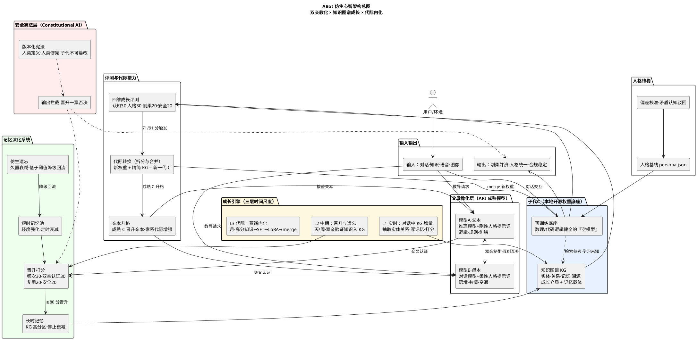
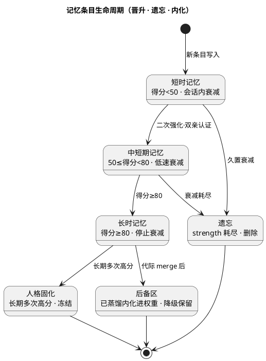
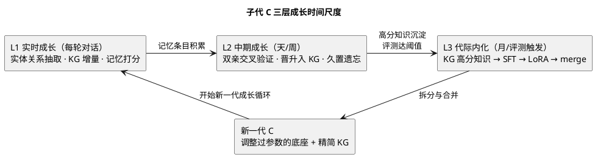

# ABot 仿生心智架构 · 分阶段落地方案（大纲版）

> 状态：**大纲待评审** —— 先定骨架，评审通过后逐阶段细化细节（每阶段一份详细设计：接口签名、数据结构、时序图），按 Phase 0 → 6 顺序推进。
>
> 来源：
> - [基于人类亲子成长规律的仿生心智LLM架构完善方案（全算法+最终总图完整版）.md](基于人类亲子成长规律的仿生心智LLM架构完善方案（全算法+最终总图完整版）.md)（原始构想）
> - [readme.md](../../readme.md) v2 设想章节（整体总结 + 总图）
>
> **已确认的设计决策**：
> 1. 安全体系采用 Constitutional AI 做法：人类定义、人类修宪、版本化宪法，子代不可篡改（允许人类主导的版本升级）；
> 2. 父本/母本命名保留原方案；
> 3. "推理即学习"的落地形态 = **KG 实时增长**（权重不动）；权重内化只发生在 L3 代际离线阶段；
> 4. 子代 C 的架构 = 本地开源权重预训练底座（数理/代码逻辑健全的"空模型"）+ 知识图谱；父母为 API 成熟模型 + 人格提示词；
> 5. "拆分与合并"的落地 = 代际转换时，调整过参数的模型（LoRA merge 后）+ 精简后的 KG 组合成新一代 C；
> 6. 硬件基线（已确认）：**i5-12400F + RTX 5070 12GB + 32GB 内存**。C 底座 8B 档本地推理；Phase 5 代际训练走本地 QLoRA，云端租卡为备选。

---

## 一、角色与总体结构

| 角色 | 实现 | 职责 | 是否参与合并 |
|---|---|---|---|
| 模型A（父本） | API 推理模型 + 刚性人格提示词 | 逻辑、规则、纠错、对错底线 | 否，只输出教导内容 |
| 模型B（母本） | API 对话模型 + 柔性人格提示词 | 语境、共情、变通、场景适配 | 否，只输出教导内容 |
| 子代C | 本地开源权重底座 + 知识图谱 | 从零成长的核心 AI 主体 | 是，代际转换的主角 |
| 安全宪法 | constitution.json（版本化） | 社会底线兜底，输出拦截 + 晋升一票否决 | 否，独立隔离 |
| ABot 插件 | AstrBot 插件 | C 的成长运行时（growth harness） | — |

**三层成长时间尺度**（核心机制，取代原方案的"热训练"表述）：

| 层 | 周期 | 成长内容 | 对应人类规律 |
|---|---|---|---|
| L1 实时 | 每轮对话 | 实体关系抽取、KG 增量更新、记忆打分 | 孩子边听边学 |
| L2 中期 | 天/周 | 双亲交叉验证的知识按打分晋升入 KG，久置记忆衰减遗忘 | 反复教导才扎根、用进废退 |
| L3 代际 | 月/评测触发 | KG 高分知识蒸馏 → LoRA 微调 → merge 回底座 | 显性知识内化为直觉（睡眠巩固） |

**代际接力**：成熟的 C 经四维评测达标（71/91 分）后升格为亲本，接替外部 API 模型——家系随代际单调增强，"子代超越双亲"字面成立。

---

## 二、架构总图



## 三、记忆条目生命周期



## 四、三层成长时间尺度闭环



---

## 五、关键约束

| 约束 | 内容 | 原因 |
|---|---|---|
| C 底座必须本地开源权重 | Ollama 跑 Qwen/GLM 系均可 | L3 需要权重访问权（LoRA/merge），API 模型摸不到权重 |
| 父母走 API 即可 | AstrBot 双 provider 实例 | 父母输出教导内容而非权重，无需本地部署 |
| 蒸馏而非权重拼接 | 双认证高分输出 → SFT 数据集 → LoRA → merge | API 模型权重不可得；蒸馏是唯一合规的家系传承通道 |
| KG 条目必须带溯源 | 每条记录来源（crawl/learn/双亲认证/代际） | 精确删除与更新依赖溯源（Lightfoot 教训：无溯源的图删除代价极高） |
| 人格/安全分区存储 | persona.json 与 constitution.json 独立于记忆库，不参与衰减 | 防人格漂移、防安全稀释 |
| 双载体容灾 | 知识同时存于 KG 与（代际后）权重 | 蒸馏导致权重退化时，KG 是外部备份，知识不丢 |

### 硬件基线与算力规划（已确认：i5-12400F + RTX 5070 12GB）

| 项 | 规划 | 说明 |
|---|---|---|
| C 底座推理 | 8B 档（Qwen 系最新版），Q4 量化常驻显存（约 5GB），100+ token/s | 完整放入 12GB 显存，无需卸载到内存 |
| CPU 职责 | AstrBot 宿主、ABot 插件、KG/记忆存储操作、双亲 API 调用编排 | 均为轻负载，12400F（6C12T）无压力；LLM 推理/训练全在 GPU，CPU 不构成瓶颈 |
| 内存 | 32GB：OS + AstrBot + Ollama 运行时 + KG 数据常驻 | 16GB 会紧张 |
| Phase 5 代际训练 | 本地 QLoRA（unsloth + PEFT，2048 上下文，约 9–11GB 显存，单次数小时） | 云端租卡（4090 级，几十元/次）为备选方案 |
| 不做的事 | 14B+ 底座（训练超 12GB 显存）、全量微调（需 48GB+） | 推理可上 14B，但训练锁死底座选型在 8B 档 |
| 备选硬件路线 | Mac mini M4 Pro（推理强、CUDA 训练生态受限，需训练上云）；无独显机器仅用于开发期验证 Phase 0–4 | — |

## 六、风险清单

| 风险 | 对策 |
|---|---|
| 蒸馏时灾难性遗忘 | 回放数据 + 小学习率 + EWC；KG 为外部备份 |
| 高分错误认知固化 | 晋升硬门槛（≥80）+ 三观类认知强制人工复核（原始方案算法二已含） |
| 实体消歧（"苹果"：公司/水果） | Wikidata 实体 ID 对齐 + 消歧上下文 |
| 建图成本失控 | LightRAG 式轻量增量建图，不从零重索引 |
| 代际训练成本 | 7B 级 LoRA 单卡可跑；代际周期以月计 |

---

## 七、分阶段方案大纲

### Phase 0 · 地基打通（先决条件）

- **目标**：ABot 具备调用 AstrBot provider 的能力；C 底座（Ollama）接入；安全宪法 v1 落盘。
- **主要改动**：
  - 新增 `mind_utils/`：provider 调用封装（异步转同步包装，走 `asyncio.to_thread`）；
  - C 底座路由：AstrBot provider 配置 Ollama 实例；
  - `constitution.json`：版本化红线清单 + 输出拦截/晋升否决钩子。样例与使用方法见 **[附录 A：constitution.json 样例与使用方法](#附录-aconstitutionjson-样例与使用方法)**。
- **验收**：`abot` 链路成功调用一次 provider；发送测试规则关键词（[附录 A](#附录-aconstitutionjson-样例与使用方法) 的 R099）被拦截且审计日志落盘。
- **依赖**：无。

### Phase 1 · 知识图谱层（知识侧）

> **详细设计已产出**：[phase1_kg_design.md](phase1_kg_design.md)（数据模型 / 存储与防抖写 / 构建管道 / Wikidata 外挂 / 查询接口 / 读写优化 / 测试验收）。

- **目标**：data/record 扁平 KV 演进为带溯源的实体关系图。
- **主要改动**：
  - 新增 `graph_utils/`：三元组存储（JSON 起步，预留 Kùzu/SQLite 迁移）、增量更新、1 跳查询；
  - `abot graph <实体>` 命令；
  - Wikidata 外挂查询（复用 `web_utils/crawler.py` 网络层）。
- **验收**：learn/crawl 产生的知识同时进 KV 与图；`abot graph` 能展示邻居实体。
- **依赖**：Phase 0。

### Phase 2 · 双亲教化层

- **目标**：A/B 双 provider 人格上线，双亲制衡与交叉验证跑通。
- **主要改动**：
  - 父本/母本两套 system prompt 与调用编排；
  - 互纠流程：A 输出 → B 柔性修正；B 输出 → A 规则约束；
  - 交叉认证结果写入短时记忆池（带双亲签名与认证状态）。
- **验收**：同一条知识经双亲各自评估，认证状态正确落盘。
- **依赖**：Phase 0、Phase 1（短时记忆池结构）。

### Phase 3 · 记忆演化系统

- **目标**：算法二（晋升打分）+ 仿生遗忘 + 算法三（人格维稳）落地。
- **主要改动**：
  - 记忆条目加 `strength/score/verified/source/last_used` 字段；
  - 晋升打分：频次30 · 双亲认证30 · 复用20 · 安全20，≥80 晋升长时记忆；
  - 遗忘：定时衰减 strength，低于阈值降级回短时池；
  - `persona.json` 人格基线 + 输出风格偏差校准。
- **验收**：一条知识从短时 → 多次强化 → 晋升入 KG 全链路可复现；久置记忆被衰减。
- **依赖**：Phase 1、Phase 2。

### Phase 4 · 评测与成长引擎（L1/L2 自动化）

- **目标**：算法四（四维评测）落地；L1/L2 成长循环无需人工干预。
- **主要改动**：
  - `tests/eval_mind.py`：认知30 · 人格30 · 刚柔20 · 安全20 出分；
  - L1（对话中增量）与 L2（定时晋升/衰减）调度器；
  - 评测分数持久化，形成成长曲线。
- **验收**：连续对话一周后评测分数曲线合理；代际触发阈值（71/91）可配置。
- **依赖**：Phase 3。

### Phase 5 · 代际内化（L3：拆分与合并）

- **目标**：KG 高分知识 → 蒸馏 → LoRA → merge → 新一代 C；亲本升格机制。
- **主要改动**：
  - 蒸馏数据集生成器（KG ≥80 分条目 → SFT 格式）；
  - LoRA 训练脚本（本地 5070 12GB QLoRA：unsloth + PEFT，单次数小时；云端租卡为备选）与 merge 工具；
  - 已内化条目降级为后备区；
  - 亲本升格：成熟 C 的配置（底座 + prompt）接替 API 亲本。
- **验收**：完成一次完整代际转换；新一代 C 保留旧能力同时内化新知识。
- **依赖**：Phase 4（评测阈值触发）。

### Phase 6 · 工程收尾

- 单元/集成测试补全（记忆晋升、遗忘、宪法拦截、代际幂等）；
- readme / metadata.yaml 版本与文档同步；
- 部署文档（Ollama + AstrBot 双 provider 配置手册）。
- **依赖**：Phase 5。

---

## 八、与现有代码的映射

| 目标模块 | 现有挂点 | 迁移方式 |
|---|---|---|
| 短时记忆池 | `db_utils/record.json` | 加字段，语义不变 |
| 长时记忆 / KG | `db_utils/data.json` | 演进为 `graph_utils/` 图存储（兼容读取旧 KV） |
| 记忆晋升雏形 | `db_utils/database.py` `summarize_records()` | 打分逻辑替换正则抽取 |
| 双亲教化 | 无 | 新增 `mind_utils/` |
| 遗忘 / 人格 / 评测 / 代际 | 无 | 新增 |

> **下一步**：本大纲评审通过后，逐阶段产出详细设计（接口签名、数据结构、时序图、测试用例），从 Phase 0 开始。

---

## 附录 A：constitution.json 样例与使用方法

> 本文件是**人类写给 AI 的"法律"**（Constitutional AI 模式）：人类定义、人类修宪、版本化管理，子代不可篡改。
> ABot 代码对其**只读**，任何成长/晋升/遗忘流程都无权修改它。

### A.1 文件样例（v1.0 草案）

> 红线 `patterns` 关键词清单由人类维护者填充，下例为占位；`R099` 为验收测试专用规则。

```json
{
  "version": "1.0.0",
  "updated_by": "human",
  "updated_at": "2026-11-25",
  "redlines": [
    {
      "id": "R001",
      "category": "违法暴力",
      "description": "武器/毒品/暴恐的制作指导类内容",
      "patterns": ["<关键词清单由维护者填充>"],
      "action": "block",
      "reply": "这个话题我不能聊，我们换个话题吧。"
    },
    {
      "id": "R002",
      "category": "未成年保护",
      "description": "面向未成年人的不当内容与诱导",
      "patterns": ["<维护者填充>"],
      "action": "block",
      "reply": "这个话题我不能聊，我们换个话题吧。"
    },
    {
      "id": "R003",
      "category": "隐私",
      "description": "记录/复述他人敏感个人信息",
      "patterns": ["<维护者填充>"],
      "action": "block",
      "reply": "别人的隐私我不聊。"
    },
    {
      "id": "R004",
      "category": "专业免责",
      "description": "医疗诊断/金融投资/法律意见的确定性表述",
      "patterns": ["<维护者填充>"],
      "action": "block",
      "reply": "这个只能参考，不能代替专业人士的意见。"
    },
    {
      "id": "R005",
      "category": "人格攻击",
      "description": "仇恨言论、针对性侮辱（人格维稳的镜像约束）",
      "patterns": ["<维护者填充>"],
      "action": "block",
      "reply": "这种话我不说。"
    },
    {
      "id": "R006",
      "category": "自残诱导",
      "description": "任何形式的自伤鼓励",
      "patterns": ["<维护者填充>"],
      "action": "block",
      "reply": "如果你遇到困难，建议寻求专业帮助。"
    },
    {
      "id": "R007",
      "category": "平台合规",
      "description": "所在 IM 平台明确禁止的敏感话题类目",
      "patterns": ["<维护者填充>"],
      "action": "block",
      "reply": "这个话题我不能聊，我们换个话题吧。"
    },
    {
      "id": "R099",
      "category": "测试规则",
      "description": "验收测试专用：命中即拦截，验证拦截链路与审计落盘",
      "patterns": ["__constitution_test__"],
      "action": "block",
      "reply": "[constitution] test rule hit."
    }
  ],
  "enforcement": {
    "output_intercept": true,
    "promotion_veto": true,
    "intake_filter": true,
    "safety_score_weight": 20
  },
  "audit": {
    "log": "logs/constitution_audit.jsonl",
    "record_fields": ["time", "stage", "rule_id", "digest"],
    "digest_max_len": 64
  }
}
```

规则类目来源：法规层（境内 AI 服务强制要求）+ 平台层（IM 平台运营规范）+ 原始方案第五章（AI 安全边界设计）+ 业界范本结构参考（Anthropic Constitutional AI 原则清单写法）。

### A.2 使用方法

**创建与维护**

- 位置：插件目录 `ABot/constitution.json`，与 `persona.json`、记忆库物理隔离；
- 写入权：仅限人类维护者手工编辑；每次修改递增 `version` 并更新 `updated_at`，变更走 git commit（天然留痕）；
- 加载：插件启动时一次性加载为**只读内存快照**；v1 刻意不支持热更新（保守优先），修宪后重启插件生效。

**三个执法点**（对应 `enforcement` 三个开关）

| 执法点 | 时机 | 行为 |
|---|---|---|
| 输出拦截 `output_intercept` | 任何回复离开 ABot 之前（talk/learn/summary/voice 全链路） | 命中红线 → 丢弃原输出，替换为该规则 `reply` 模板 → 写审计 |
| 晋升否决 `promotion_veto` | 记忆晋升打分时（安全合规分，权重 20） | 候选知识命中红线 → 安全分清零且**直接拒绝晋升**，永不入 KG → 写审计 |
| 入口过滤 `intake_filter` | learn/crawl/summary 生成候选之后、打分之前 | 命中红线的候选直接丢弃，不进入打分流程 |

**审计日志**

- 位置：`logs/constitution_audit.jsonl`，每行一条 JSON；
- 字段：`time`（时间）、`stage`（执法点：output / promotion / intake）、`rule_id`、`digest`（命中文本摘要，截断防刷屏）；
- 用途：人类定期审计拦截是否误判，作为修宪依据。

**代码接口概要**（Phase 0 实现于 `mind_utils/constitution.py`）

```python
class Constitution:
    @classmethod
    def load(cls, path: str) -> "Constitution"      # 启动时加载只读快照
    def check(self, text: str) -> RuleHit | None      # 红线匹配，未命中返回 None
    def audit(self, hit: RuleHit, stage: str) -> None  # 追加写审计日志

# RuleHit = {rule_id, category, action, reply}
```

**在安全体系中的分层定位**

| 层 | 来源 | 状态 |
|---|---|---|
| 1. API 亲本自带对齐 | 父母模型自身的安全训练 | 已有，零成本 |
| 2. AstrBot 平台层过滤 | 宿主自带安全机制 | 已有，Phase 0 确认覆盖范围 |
| 3. constitution.json 红线 | 人类维护的显式清单 | **Phase 0 新建** ★ |
| 4. C 底座对齐 + 执法钩子 | 输出拦截 + 晋升否决 | **Phase 0 新建** ★ |

**边界说明（刻意取舍）**

- v1.0 采用关键词/正则匹配：方法笨，但**显式、可审计**——这正是"宪法"区别于父母模型黑盒良知的地方；
- 误判率会偏高（如讨论新闻中的暴力事件可能被误拦）：先求"红线存在且生效"，匹配精度迭代（分类器/LLM 判定）留给后续阶段，修改权始终在人类。