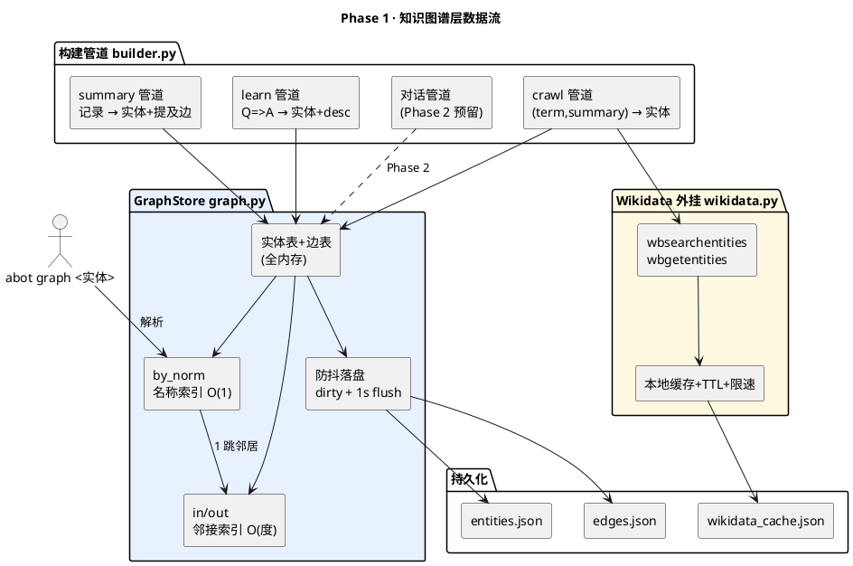

# Phase 1 · 知识图谱层 详细设计（知识侧）

> 状态：**设计稿，待评审**。对应 [detail_plan.md](detail_plan.md) Phase 1。
> 范围：`graph_utils/` 新模块（存储/构建/查询/Wikidata 外挂）+ `abot graph` 命令 + learn/crawl 管道接线。
> 不在本期：图引导检索接入三层 `find()`（Phase 2）、记忆晋升打分（Phase 3）、双亲 LLM 抽取（Phase 2）。

---

## 一、设计目标

1. **构建**：learn / crawl / summary 三条现有知识管道产生的知识，同时进入图（实体 + 关系），每条必带溯源；
2. **存储**：JSON 起步，全内存索引，接口与后端解耦（预留 SQLite/Kùzu 迁移，不换调用方代码）；
3. **查询**：`abot graph <实体>` 展示实体卡与 1 跳邻居；有界 k-hop 子图接口留给 Phase 2/3 组 LLM 上下文；
4. **性能**：万级实体 / 十万级边内全内存 O(1)~O(度) 查询；写入防抖批量落盘，高频路径不卡对话。

## 二、数据模型

### 2.1 实体（`graph_utils/data/entities.json`）

```json
"e_000001": {
  "id": "e_000001",
  "name": "人工智能",
  "aliases": ["AI", "机器智能"],
  "desc": "研究和开发用于模拟、延伸和扩展人的智能的理论…",
  "norm": "人工智能",
  "source": "crawl",
  "wikidata_id": "Q11660",
  "created_at": "2026-11-25 17:40:00",
  "last_used": "2026-11-25 18:00:00",
  "use_count": 3,
  "strength": 1.0
}
```

| 字段 | 说明 |
|---|---|
| `id` | 自增 `e_%06d`，进程内计数器持久化到 `meta.json` |
| `norm` | `text_utils.normalize(name)`，主索引键（复用现有规范化：全半角/大小写/标点） |
| `aliases` | 别名表，每个别名的 norm 也指向同一 id（实体对齐第一道防线） |
| `source` | 溯源：`learn / crawl / record / parent / generational`（必填） |
| `strength` / `use_count` / `last_used` | Phase 3 遗忘机制的钩子，本期只写不读 |

### 2.2 边（`graph_utils/data/edges.json`）

三元组，去重键 = `"s|p|o"`：

```json
"e_000001|属于|e_000002": {
  "s": "e_000001",
  "p": "属于",
  "o": "e_000002",
  "o_type": "entity",
  "source": "crawl",
  "confidence": 0.9,
  "created_at": "2026-11-25 17:40:00"
}
```

- `o_type: "entity"` 时 `o` 为实体 id；`"literal"` 时 `o` 为字面值（如 `"e_000003|成立时间|#1956"`）——属性值不成实体，防实体表爆炸；
- `p`（谓词）Phase 1 使用受控小词表：`属于 / 包含 / 部分 / 提及 / 相关 / 属于类目` + Wikidata 谓词标签直译；开放谓词留给 Phase 2 双亲 LLM 抽取。

## 三、存储设计

### 3.1 文件布局与内存结构

```
graph_utils/
  __init__.py
  graph.py        # GraphStore：内存图 + 索引 + 防抖落盘
  builder.py      # 构建管道：learn/crawl/summary → 三元组
  wikidata.py     # 外挂适配器：wbsearchentities / wbgetentities + 缓存
  data/
    entities.json
    edges.json
    meta.json           # id 计数器
    wikidata_cache.json
```

`GraphStore` 首次访问时惰性全量加载（与现有 `DB.load()` 同模式），常驻内存：

| 内存结构 | 类型 | 用途 |
|---|---|---|
| `_entities` | `dict[id, Entity]` | 实体表 |
| `_edges` | `dict[dedup_key, Edge]` | 边表（天然去重） |
| `_by_norm` | `dict[norm, id]` | 名称/别名索引：**O(1) 实体解析** |
| `_out` / `_in` | `dict[id, set[dedup_key]]` | 邻接索引：**O(度) 1 跳查询** |

并发：模块级 `graph_lock = threading.RLock()`，与 `db_lock` 同模式。

### 3.2 写策略（读快写不堵）

| 路径 | 频率 | 策略 |
|---|---|---|
| 命令触发（learn/crawl/summary/graph） | 低频 | 内存变更后**立即 flush**（复用 `FileUtils.write_json` 原子写） |
| 对话内抽取（Phase 2 的 L1 高频路径） | 每轮对话 | 内存变更 + `dirty` 标记 + **防抖线程 1s 批量落盘**；`terminate`/`stop` 强制 flush |
| 查询命中 `touch()` | 高频只读 | 只改内存字段（`use_count/last_used`），随防抖落盘——**查询永远不直接触发写盘** |

设计原则与现有 `database.py` 的"即时落盘"一致：低频路径宁可多写一次盘（毫秒级），高频路径靠防抖聚合。崩溃丢失窗口 ≤ 1s，可接受；`FileUtils.write_json` 的临时文件 + `os.replace` 原子写保证任何时刻不产生半个 JSON。

### 3.3 容量预算与迁移阈值

| 指标 | JSON 舒适区 | 迁移触发线 | 迁移目标 |
|---|---|---|---|
| 实体数 | < 2 万 | 5 万 | SQLite |
| 边数 | < 10 万 | 20 万 | SQLite |
| 单文件体积 | < 20MB | 50MB | SQLite |
| 冷启动 load | < 0.5s | > 2s | SQLite（增量加载） |
| 多跳分析需求 | — | 需要 3 跳以上遍历/图算法 | Kùzu |

迁移不换调用方：`GraphStore` 是接口（Strategy），`graph.py` 提供 JSON 实现，未来新增 `graph_sqlite.py` 实现同接口 + 一次性迁移脚本。SQLite 版要点：`edges PK(s,p,o)`、`entities.norm UNIQUE`、名称/别名检索走 FTS5、邻接走 `(s)`/`(o)` 索引。

## 四、构建管道

### 4.1 三条管道 + 一条预留

| 管道 | 触发点 | 抽取逻辑 | 产出 |
|---|---|---|---|
| **learn 管道** | `DB.update()`（`Q => A`） | Q 整体 upsert 为实体，A 首句（≤100 字）作 `desc`；A 中能解析到已有实体的词建 `相关` 边 | 1 实体 + 0~N 边 |
| **crawl 管道** | `DB.learn_url()` | 每个 `(term, summary)` upsert 实体 + `desc`；`wikidata.search_entity(term)` 命中 → 绑 `wikidata_id` + 拉取结构化三元组（见 4.3） | N 实体 + M 边 |
| **summary 管道** | `DB.summarize_records()` | 与 KV 同步：每条导入记录的 key upsert 实体，与原句建 `提及` 边 | N 实体 + N 边 |
| **对话管道（预留）** | Phase 2 L1 实时成长 | `builder.from_text()` 接口已留空实现：jieba 抽实体骨架可用，双亲 LLM 抽取增强到 Phase 2 接入 | — |

所有管道共用一个入口原则：**先过 `constitution` 入口过滤（Phase 0 钩子），再进图**。

### 4.2 实体对齐（消歧第一道防线）

Phase 1 采用保守三层对齐，不引入 embedding：

1. `norm` 精确对齐：`normalize(新名) ∈ _by_norm` → 复用既有实体（合并 aliases/desc）；
2. 别名对齐：新名的 norm 命中既有实体别名表 → 复用；
3. Wikidata ID 对齐：两边都有 `wikidata_id` 且相等 → 同一实体（最强判据）。

三者都不中 → 新建实体。**歧义名（"苹果"指公司还是水果）Phase 1 不做自动消歧**：无 Wikidata 绑定时按 `norm` 直接管够用（个人知识库语境单一）；消歧上下文判定留给 Phase 2 双亲交叉验证。

### 4.3 Wikidata 外挂（`wikidata.py`）

| 项 | 设计 |
|---|---|
| 实体搜索 | `https://www.wikidata.org/w/api.php?action=wbsearchentities&search=<term>&language=zh&format=json` |
| 三元组拉取 | `action=wbgetentities&props=labels|descriptions|claims`，只取**谓词白名单**（P31 实例于 / P279 子类 / P361 部分 / P527 组成 / P159 总部 / P571 成立…约 15 个通用谓词），`o` 为实体时取其 zh 标签，每实体上限 10 边 |
| 缓存 | `wikidata_cache.json`：`{norm_term: {fetched_at, data}}`，TTL 30 天，命中缓存零网络 |
| 限速 | 请求间隔 ≥ 0.5s（复用 `crawler.py` 的 `_get` 限速模式） |
| 降级 | 网络不可达（含大陆访问受限）时**静默降级**为现有 `wiki_summary` 路径，crawl 主流程不阻塞；支持配置镜像域名（`wikidata_mirror` 环境项） |

注意：Wikidata 拉回的三元组 `source` 标 `crawl`、`confidence` 0.9（外挂权威数据），与其他来源在溯源字段区分。

## 五、查询设计

### 5.1 命令：`abot graph <实体>`

```
abot graph 人工智能
→
[人工智能] (aliases: AI, 机器智能; source: crawl; 度: 12)
  描述: 研究和开发用于模拟…的理论…
  ├─ 属于 ─→ 计算机科学
  ├─ 包含 ─→ 机器学习, 自然语言处理, 计算机视觉
  └─ 相关 ─→ 算法, 深度学习
  (第 3/12 边起省略，用 abot graph 人工智能 -a 查看全部)
```

- 解析失败时：`difflib.get_close_matches` 给近似建议（复用 L3 编辑距离思路）：`unknown: xxx. did you mean: …`；
- 输出上限：默认 20 边，`-a` 全量（防止刷屏，与 `records` 命令风格一致）。

### 5.2 程序接口（Phase 2/3 消费）

```python
def subgraph(self, seed_ids, depth=1, max_nodes=30, max_edges=60) -> dict
```

有界 BFS：`visited` 集合 + 节点/边双上限，超出即截断——这是将来"图提供思路"（k-hop 子图 → LLM 上下文）的核心读取口，本期实现 depth=1 用途并保证 depth=2 可用。

## 六、模块接口（签名）

```python
# graph_utils/graph.py
class GraphStore:
    def __init__(self, data_dir=None): ...
    # 构建
    def upsert_entity(self, name, aliases=None, desc=None,
                      source="learn", wikidata_id=None) -> str        # 返回 id，已存在则合并
    def link(self, s_id, p, o, o_type="entity",
             source="learn", confidence=1.0) -> bool                  # 去重，已存在返回 False
    # 查询
    def resolve(self, name) -> "Entity | None"                        # norm/别名/wikidata_id 三层
    def neighbors(self, e_id, direction="both", limit=20) -> list
    def subgraph(self, seed_ids, depth=1, max_nodes=30, max_edges=60) -> dict
    # 生命周期
    def touch(self, e_id): ...                                        # 查询命中计数（不触发写盘）
    def flush_if_dirty(self): ...                                     # 防抖落盘入口
    def flush(self): ...                                              # 立即落盘（命令路径用）

# graph_utils/builder.py
def from_learn_entry(key: str, value: str) -> int                     # 返回新增三元组数
def from_crawl_entries(entries: list[tuple[str, str]]) -> int
def from_summary(items: list[dict]) -> int
def from_text(text: str) -> int                                       # Phase 2 占位：jieba 骨架

# graph_utils/wikidata.py
def search_entity(self, term: str, lang="zh") -> "dict | None"        # {qid, label, desc}
def fetch_triples(self, qid: str, lang="zh", max_edges=10) -> list    # [(s_label, pred_label, o_label)]
```

接线点：`DB.update()` / `DB.learn_url()` / `DB.summarize_records()` 末尾各加一行 `builder.from_xxx(...)`（锁外执行构建、锁内合并写入，与 `learn_url` 现有"抓取在锁外"模式一致）。

## 七、数据流总图



## 八、读写速度优化（汇总）

| # | 优化 | 层面 | 效果 |
|---|---|---|---|
| 1 | 全内存图 + 三级索引（`by_norm` / `in` / `out`） | 读 | 实体解析 O(1)，1 跳 O(度)，万级实体毫秒内 |
| 2 | 防抖批量落盘（1s 窗口聚合 + 原子写） | 写 | 高频路径每秒至多一次盘 IO；低频路径立即落盘不牺牲可靠性 |
| 3 | `touch()` 只动内存，随防抖持久化 | 读→写耦合 | 查询计数不产生写盘延迟 |
| 4 | 边表去重键天然防膨胀（重复知识不重复存储） | 容量 | 同一三元组 N 次学习只存一份 |
| 5 | Wikidata 本地缓存 + TTL + 限速 | 网络 | 重复术语零网络；冷术语限速防封锁 |
| 6 | 网络失败静默降级 + `confidence` 溯源标记 | 可用性 | 外挂不可达不阻塞主流程 |
| 7 | 迁移阈值表 + Strategy 接口 | 容量演进 | 超阈值换 SQLite 实现零调用方改动 |
| 8 | `graph_lock` RLock + "构建在锁外、合并写锁内" | 并发 | 不卡 asyncio 事件循环（沿用 `learn_url` 模式） |

## 九、测试与验收

**单元测试**（`tests/test_graph.py`，tmp 目录隔离，不依赖 astrbot）：

- upsert 去重合并（同名/别名/Wikidata ID 三种对齐路径）；
- link 去重、literal 边、subgraph 深度/上限截断；
- 防抖 flush：dirty → flush_if_dirty → 文件内容与内存一致；崩溃窗口语义（未 flush 的变更允许丢失但文件不损坏）；
- wikidata mock：缓存命中不发网络请求。

**验收清单**（对齐 detail_plan.md Phase 1）：

- [ ] `abot 你好 => 世界` 后 `abot graph 你好` 能展示实体卡；
- [ ] `abot crawl <wiki url>` 后 `abot graph <页面主题>` 展示 Wikidata 拉取的邻居（或网络降级时仅 desc）；
- [ ] `abot summary` 后图中有 `提及` 边；
- [ ] 重复学习同一词条，`edges.json` 不增长（去重生效）；
- [ ] 冷启动加载 1 万实体 + 5 万边的构造数据 < 0.5s（性能基线测试）。