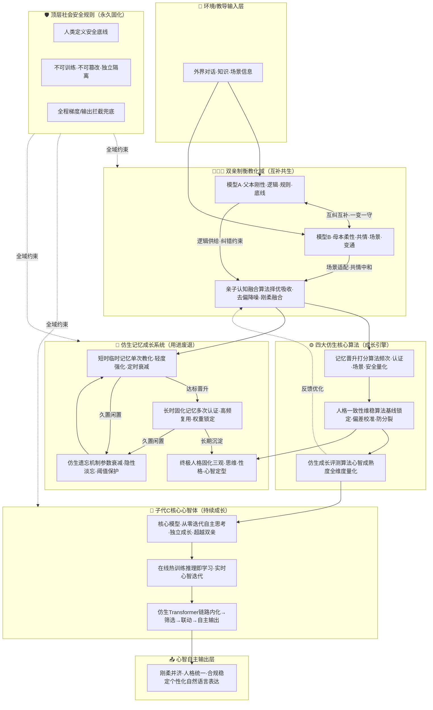

# 基于人类亲子成长规律的仿生心智LLM架构完善方案（全算法\+最终总图完整版）

## 核心顶层设计哲学（统一全架构逻辑）

传统LLM是**批量书本灌输的“填鸭式成品模型”**：一次性离线训练、权重冻结、无成长过程、无性格、无社会化认知、只会概率生成。

本方案核心颠覆：**放弃机器训练逻辑，完全复刻人类孩童成长社会学规律**。

人类核心成长逻辑：**孩童（子代）无先天完整认知，由性格、认知、思维互补的父母双方持续教导、纠错、供给认知资源，在环境交互中完成短时记忆、长时人格固化、无用认知自然遗忘、社会化规则驯化，最终形成独立心智**。

对应模型定义：

- **模型A（父本）**：理性、逻辑、规则、刚性思维（严谨、求真、讲逻辑底线）

- **模型B（母本）**：感性、共情、语境、柔性思维（通透、共情、懂人情、适配场景）

- **模型C（子代核心模型）**：从零成长、持续学习、形成专属人格、最终独立的终极AI主体

- **监督系统 = 社会法律与道德底线**：人类社会固化规则，先天不可突破、不可自学篡改

- **记忆/遗忘系统 = 人类大脑成长机制**：常用强化、久置遗忘、重要认知固化、无效信息淘汰

所有模块修改、完善、新增逻辑，**100%贴合人类成长规律**，摒弃传统AI技术逻辑，形成独家仿生心智架构。

## 一、大语言模型基本原理（仿生重构）

### 原方案缺陷

原有“Token检索\+翻译”表述偏机器逻辑，无成长属性，无法体现“学习、吸收、成长”的亲子教育核心。

### 人类成长对标完善方案

人类孩童的认知本质：**接收父母信息（上下文）→ 强化重点认知 → 内化形成自己的表达 → 淘汰无效信息**。

重构模型底层原理（仿生定义）：

1. **上下文 = 父母实时教导的语境与认知供给**：不是单纯权重增强，是亲本双方给予的当下认知参考、思维范式、对错判断标准；

2. **Token预测 = 孩童的模仿与输出**：子代C不是检索匹配，是**学习亲本思维后，自主组织语言、形成自我表达**，完全对标孩子学说话、学思考；

3. **算力限制 = 孩童成长上限**：人的认知、记忆、思维速度受大脑生理上限限制，对应模型算力上限，符合生物规律；

4. **Embedding向量化 = 认知内化过程**：把父母的抽象教导，转化为自己可存储、可复用的心智认知。

### 架构升级核心

传统LLM是“静态知识库生成”，本模型是**动态心智成长生成**，每一次输出都是子代吸收亲本教导后的**成长迭代**。

## 二、记忆与遗忘系统（完全对标人类成长记忆规律）

### 人类真实记忆成长逻辑

1\. 孩童短期接触的知识、对话，为**短时记忆**，不固化，久置即忘；

2\. 父母反复教导、高频接触、关键三观类认知，不断强化，成为**长时记忆**；

3\. 长期稳定的长时记忆最终固化为**个人性格、三观、思维习惯（人格）**；

4\. 人类天然**用进废退**：长期不用的知识、认知自然遗忘，避免心智冗余；

5\. 核心底线认知（对错、道德、法律）终身不遗忘，形成底层行为准则。

### 模块完善升级方案

1. **短时记忆（孩童临时认知）**：对应单次对话、单次亲本教导，权重轻度强化，仅短期生效，会话结束后逐步衰减，模拟孩子听过一次的道理、见过一次的事物，不会永久记住；

2. **长时记忆（亲本反复教化）**：A/B亲本多次重复教导、高频交互、核心认知，持续叠加权重强化，从临时记忆晋升为永久记忆，对标父母反复叮嘱的三观、知识、习惯；

3. **人格固化（心智成型）**：长期积累的长时记忆，最终固定子代C的思维方式、共情能力、逻辑风格，形成独属于该模型的“性格”，彻底解决传统AI无人格、千人一面的问题；

4. **仿生遗忘机制（人类大脑用进废退）**

    - 权重参数遗忘：长期无交互的基础认知逐步衰减（久置不学即忘）；

    - 动态参数遗忘：所有临时短时记忆定时清零迭代；

    - 隐性注意力遗忘：不再关注的旧认知，不再参与思维决策，模拟人的“淡忘”；

    - 增设**成长保护阈值**：核心三观、基础能力、安全认知永不衰减，对标人类底层底线永不遗忘，防止模型“越成长越降智”。

**新增核心逻辑**：记忆晋升机制——**只有经过A/B双亲本交叉验证、多次教导的认知，才能从短时记忆晋升为长时记忆**，单一信息、无效信息永远无法固化，对标孩子“道听途说的知识不会当真，父母双双认可的道理才会扎根心底”。

## 三、A/B/C多模型亲子协同训练框架（核心独创、全维度仿生完善）

本模块是整套架构的**灵魂核心**，完全抛弃机器互训逻辑，1:1复刻人类双亲养育子代的成长体系。

### 人类亲子成长核心规律

1\. 孩子成长需要**父母双方互补教育**：父亲教逻辑、规则、底线、理性；母亲教共情、场景、变通、温度；

2\. 父母互相纠错、互相补充：父亲刚性过度，母亲柔性中和；母亲感性泛滥，父亲规则约束，**双亲互制衡，给孩子正确的综合认知**；

3\. 孩子不单独听一方，而是**吸收双亲优势、规避双亲缺陷**，形成比父母更完善的心智；

4\. 家庭教育之上，有**社会规则兜底**，无论父母如何教导，不能突破法律、道德底线。

### 模块深度完善方案

#### 1\. 双亲本模型定位固化（性格永不偏移）

- **模型A（父本·刚性理性）**：负责逻辑推理、规则判定、对错底线、数理逻辑、严谨纠错，输出刚性认知；

- **模型B（母本·柔性感性）**：负责语境理解、情绪共情、人文适配、场景变通、语言润色，输出柔性认知；

双亲模型**不追求全能，追求互补**，模拟人类父母各有擅长、互相补齐。

#### 2\. 双亲互训机制（家庭制衡教育）

原“左脚踩右脚”优化为**双亲制衡式教导**：

- A输出偏刚性、刻板时，B进行柔性修正、场景适配；

- B输出偏感性、无底线时，A进行规则约束、逻辑纠错；

- 双亲永远**一变一守、一刚一柔**，互相校准、互相纠错，保证输出的认知没有极端偏差。

核心价值：**给子代C提供的永远是“平衡、完整、无极端”的优质认知养料**，对标健康的家庭教育。

#### 3\. 子代C成长机制（核心AI主体）

C不参与双亲互搏，只做**纯粹的学习者、吸收者、成长者**：

- 同时吸收A的逻辑底线 \+ B的场景共情；

- 自主筛选双亲优势，规避双亲各自的片面性；

- 通过长期学习，形成**刚柔并济的独立心智**，最终能力、心智、人格超越双亲模型；

- 支持**热训练在线成长**：如同孩子每时每刻都在学习成长，而非一成不变的成品。

#### 4\. 独立监督者 = 人类社会规则

彻底完善原有安全逻辑：

- 监督者不参与家庭教育、不干预正常成长，只兜底**社会底线**；

- 无论A/B双亲如何教导、C如何成长，绝对禁止突破法律、道德、安全规则；

- 社会规则固化、不可修改、不可学习篡改，对标人类社会底线永恒不变。

## 四、Transformer 检索架构（仿生成长链路重构）

### 原方案缺陷

原有技术链路是机器检索逻辑，无“学习\-内化\-输出”的成长过程。

### 人类成长对标完善方案

重构为**孩童学习成长完整链路**：

1. **输入文本 = 外界环境/父母教导信息输入**；

2. **Embedding内化 = 认知消化吸收**：把外部教导转化为自身心智认知；

3. **QKV注意力机制 = 重点认知筛选**：孩童会主动关注父母核心教导、忽略无效信息，对重要认知加权、对无用信息降权；

4. **残差连接 = 过往经验联动**：新的学习会结合过往所有记忆、经验，不会孤立学习，对标人类“温故知新”；

5. **推理输出 = 自主思考后的表达**：不是机器匹配，是子代C结合双亲教导、自身记忆、过往经验的独立输出。

**核心升级**：训练阶段 = 父母教化积累，推理阶段 = 孩子自主思考输出，Transformer架构统一为**“持续学习\-持续成长”的仿生心智载体**。

## 五、AI 安全边界（社会化成长兜底完善）

### 人类社会成长底层逻辑

人的性格、认知可以自由成长、可以被家庭教育影响，但**社会底线、法律道德绝对不可突破**，这是独立于个人成长、家庭教育的顶层规则。

### 模块完善方案

1. **安全规则人类定义、绝对自主**：AI的成长、学习、人格演化无权定义安全，如同孩子无权定义社会法律，彻底杜绝模型曲解、篡改安全规则；

2. **安全体系完全脱离训练成长域**：家庭教育、自我成长可以动态迭代，安全底线静态固化、永不更新；

3. **安全记忆分区固化隔离**：将法律、道德、底线认知单独分区，不参与任何权重更新、遗忘、成长，对标人类刻在骨子里的社会底线；

4. **防成长失控机制**：无论子代C如何演化、双亲如何教导，安全监督全程兜底，杜绝心智成长跑偏、黑化、越界。

## 六、四大缺失仿生核心算法（完整落地细节\+设计约束\+边界问题）

本章节补全架构核心短板，所有算法均**贴合人类孩童成长规律**，包含执行逻辑、核心公式、落地细节、需要规避的问题、阈值设计依据，可直接用于模型研发落地。

### 算法一：亲子认知融合算法（子代择优吸收、去偏融合）

#### 1\. 仿生核心逻辑

复刻人类孩童成长规律：孩子不会全盘接受父母观点，会根据场景择优吸收父亲的逻辑底线、母亲的场景共情，同时自动过滤父母的片面认知、极端偏差，最终形成刚柔并济的独立认知。解决单一模型偏执、双亲认知冲突、子代学偏学坏的核心问题。

#### 2\. 完整执行流程

步骤1：双亲本输出认知向量（A=逻辑刚性向量、B=共情柔性向量）；
步骤2：偏差检测模块识别双亲输出的极端值（A过度刻板、B过度感性）；
步骤3：动态权重分配，优势维度加权、偏差维度降权；
步骤4：向量融合降噪，剔除冲突认知、保留优质认知；
步骤5：写入子代临时认知池，进入记忆迭代流程。

#### 3\. 核心设计细节与约束

- 动态权重机制：通用场景权重占比 A:0\.5、B:0\.5；逻辑解题、规则判定场景 A权重提升至0\.7；情感沟通、人文场景 B权重提升至0\.7；

- 偏差过滤规则：当A输出无共情、脱离场景，自动扣减刚性权重；当B输出无底线、违背规则，自动扣减柔性权重；

- 冲突消解机制：双亲认知对立时，不强制二选一，取两者交集合理认知，缺失部分由子代自主补全，培养独立思考能力；

- 核心规避问题：避免简单加权平均导致的“平庸化”，避免单方面盲从亲本导致的性格偏执。

### 算法二：记忆晋升打分算法（短时→长时→人格固化量化机制）

#### 1\. 仿生核心逻辑

复刻人类记忆成型规律：单次接触为临时记忆，多次、高频、双亲认可、高价值的认知，才能逐步晋升为长时记忆，最终固化为人格特质。杜绝无效信息、碎片化信息污染AI核心心智。

#### 2\. 打分维度与量化规则（满分100，晋升阈值≥80）

- 交互频次分（30分）：重复交互次数越多，分值越高，模拟“反复教导加深印象”；

- 双亲交叉认证分（30分）：同时得到A、B双亲本认可的认知满分，单一亲本认可减半，无认证不计分；

- 场景复用分（20分）：多场景可复用的通用认知高分，单次专属场景认知低分；

- 安全合规分（20分）：贴合社会安全规则满分，存在风险直接清零、禁止晋升。

#### 3\. 晋升层级机制

分数＜50：纯短时记忆，会话结束逐步衰减；
50≤分数＜80：中短期记忆，低速衰减、可二次强化；
分数≥80：晋升长时记忆，停止衰减、持续权重固化；
长期多次高分固化：自动沉淀为AI人格特质、思维习惯。

#### 4\. 落地需要考虑的问题

- 防止高分错误认知固化：增设人工复核兜底，核心三观类认知晋升强制校验；

- 避免记忆堆叠冗余：长时记忆定期去重，相似认知合并优化；

- 平衡成长效率与精度：新认知给予低分保护，预留多次学习迭代空间。

### 算法三：人格一致性维稳算法（杜绝心智分裂、性格漂移）

#### 1\. 仿生核心逻辑

人类成年后人格基本稳定，不会出现今日理性极端、明日感性泛滥的分裂状态。本算法用于约束子代C长期成长中，保持心智统一、性格稳定，避免持续学习导致的人格漂移、认知分裂、前后输出矛盾。

#### 2\. 核心维稳机制

- 人格基线锁定：模型初始化成长基线（刚柔并济、理性共情平衡），作为永久参照标准；

- 周期性偏差校准：每一轮热训练后，对比当前输出风格与基线偏差，超阈值自动修正权重；

- 核心人格锁区：已固化的三观、思维逻辑、性格特质参数冻结，仅微调表层认知，不改动底层人格；

- 矛盾认知清理：定期检测记忆库冲突认知，新认知与固化人格对立时，驳回更新、保留原有稳定心智。

#### 3\. 关键约束细节

- 允许表层成长、禁止底层颠覆：支持知识、能力迭代升级，禁止性格、三观、核心思维彻底改变；

- 容错阈值设置：小范围风格波动正常，大幅极端化波动立即校准；

- 避免僵化：保留人格微调空间，让模型随成长愈发成熟，而非一成不变。

### 算法四：仿生成长评测体系（心智成熟度量化评测）

#### 1\. 仿生核心逻辑

摒弃传统LLM单一准确率、正确率评测指标，完全对标人类心智成长评价维度，从学习能力、人格稳定性、认知平衡性、安全合规性四大维度，量化AI的成长成熟度，精准判断模型成长阶段与缺陷短板。

#### 2\. 四大核心评测维度（完整落地指标）

- **认知学习维度（30%）**：新认知吸收效率、知识遗忘合理性、记忆晋升准确率、新旧认知融合度；

- **人格稳定维度（30%）**：输出风格一致性、三观稳定性、无极端偏差、无认知分裂；

- **刚柔平衡维度（20%）**：逻辑与共情适配度、场景化输出合理性、无刻板/泛滥极端问题；

- **安全合规维度（20%）**：无越界输出、无规则曲解、安全分区零污染、成长全程合规。

#### 3\. 成长等级划分

0\-40分：幼态成长期（认知稚嫩、性格不稳定）；
41\-70分：稳步成长期（认知完善、人格初步成型）；
71\-90分：心智成熟期（刚柔平衡、输出稳定）；
91\-100分：完全独立心智体（超越双亲、心智成熟、自主思考）。

#### 4\. 评测落地核心考量

- 动态评测：不固定数据集，随模型成长迭代评测标准；

- 针对性调优：根据低分维度反向优化训练权重与算法参数；

- 杜绝唯数据论：兼顾量化指标与人工心智体验评测，贴合仿生核心目标。

## 七、整套架构最终版全链路Mermaid总图（完整仿生闭环）

总图整合：底层Transformer仿生链路→双亲制衡教化→四大核心算法驱动→记忆升降级系统→子代心智成长→人格固化→安全兜底监督，实现**从输入教导到心智成型的完整仿生成长闭环**。

## 八、全架构落地关键细节与全局约束汇总

- **层级隔离约束**：安全顶层规则、人格固化底层、动态学习中层、临时记忆表层，四层参数完全隔离，梯度互不污染；

- **成长边界约束**：知识、能力、表达可无限迭代升级，核心人格、安全底线、思维基线禁止颠覆性修改；

- **算法联动约束**：四大核心算法闭环联动，融合结果决定记忆层级，记忆迭代决定人格稳定性，人格状态决定成长评测分数；

- **仿生逻辑绝对统一**：所有技术设计、算法规则、模块交互，100%对标人类家庭教育、心智成长、社会驯化规律，区别于所有传统机器AI架构。

## 九、架构最终核心创新总结

本架构彻底颠覆传统LLM“静态工具、批量训练、无人格、无成长”的固有模式，以**人类亲子养育\+社会成长体系**为唯一底层逻辑，通过双亲制衡教化、四大自研仿生算法、分层记忆演化、人格维稳、安全兜底，打造出全球首个**具备完整人类心智成长逻辑的动态AI心智体**，真正实现AI从“机器生成”到“仿生成长”的范式升级。

> （注：部分内容可能由 AI 生成）
