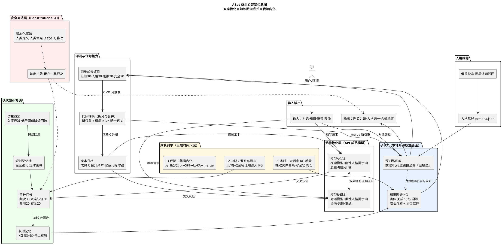

# ABot

> 一个用数据库检索驱动的对话机器人，AstrBot 插件（`>=4.17.0`）。

## 功能

| 能力 | 说明 |
|---|---|
| 对话 TALK | 三层检索知识库：规范化精确匹配 → jieba 分词重合度 → 编辑距离近似 |
| 学习 LEARN | `问题 => 回答`（多答案用 `|` 分隔）；支持从网页/维基百科递归抓取词条 |
| 记录 RECORD | 记录用户语录，`summary` 命令把记录汇总进知识库 |
| 语音 | 语音输入（Record/silk → wav → ASR）、语音回复（TTS，`voice on` 开启） |
| 多语言 | `lang chinese|english` 控制识别语言与 TTS 音色 |

## 快速开始

```
abot hello                       # 对话
abot switch 3                    # 进入学习模式
abot 你好 => 嗨，很高兴见到你     # 学习词条
abot switch 1                    # 回到对话模式
abot 你好                        # -> 嗨，很高兴见到你
```

## 命令

```
abot <text>                  在当前模式下对话/学习/记录
abot switch <0-3>            切换模式: 0=init 1=talk 2=record 3=learn
abot records [clear]         查看/清空记录
abot summary [keep]          把记录汇总进知识库（keep 保留记录）
abot forget <question>       删除一个已学习的词条
abot crawl <url>             从网页学习（抓正文→提名词→维基百科补定义）
abot lang <chinese|english>  设置语音语言
abot voice <on|off>          开启/关闭语音回复
abot voice <private|group>   语音输入作用域（默认仅私聊）
abot stop                    停止并保存
abot help                    显示帮助
```

学习模式里直接发送 URL 也会触发抓取学习。

## 语音说明

- **语音输入**：收到语音后自动转写并按当前模式处理（默认仅私聊响应，避免群聊刷屏）。
- **识别引擎**：装有 `faster-whisper` 时中英文通用（本地离线）；
  否则英文回退 Sphinx，中文需安装 `pip install faster-whisper`
  或开启 AstrBot 自带 STT（转写文本会直接复用）。
- **语音回复**：`abot voice on` 后回复语音（pyttsx4 系统语音，输出 wav，
  单条回复最多朗读 200 字，超出部分只朗读开头）。
  Windows 自带中文音色（如 Huihui）；Linux 需安装 espeak-ng。
- **QQ 语音格式**：aiocqhttp 收到的语音常为 silk，需 `pip install pilk` 转码；
  装有 ffmpeg 时 amr/mp3 等格式也能自动转换。

## 可选依赖

```
pip install pilk            # QQ silk 语音转码（Python<=3.11 的预编译包）
pip install faster-whisper  # 本地中英文语音识别（首次运行会下载模型）
```

## 开发与测试

```
# 端到端冒烟（无需安装 AstrBot）
python tests/smoke_repl.py

# 单元测试（pytest 可用时）
python -m pytest tests -q
# 或纯 Python 运行
python tests/run_tests.py
```

## 数据文件

- `db_utils/data.json`：知识词条（`问题: 回答`，回答可为字符串或多答案数组）
- `db_utils/record.json`：语录记录

---

## v2 设想：仿生心智架构（双亲教化 × 知识图谱成长 × 代际内化）

> 完整分阶段落地方案见 [docs/design/detail_plan.md](docs/design/detail_plan.md)（含三张 PlantUML 图 + Phase 0–6 大纲）；
> 原始构想见 [基于人类亲子成长规律的仿生心智LLM架构完善方案（全算法+最终总图完整版）.md](docs/design/基于人类亲子成长规律的仿生心智LLM架构完善方案（全算法+最终总图完整版）.md)。

### 整体总结

以人类亲子成长规律为唯一底层逻辑，此前三条设想在此合一：

| 设想线 | 解决的问题 | 载体 |
|---|---|---|
| 知识侧（实体关系图谱，见下节） | "知道什么" | 知识图谱 + Wikidata 外挂 |
| 心智侧（亲子成长方案） | "是谁、怎么长大" | 双亲教化 + 记忆晋升 + 人格固化 |
| 目标线（12 岁儿童水平） | 验收标准 | 知识侧认知超儿童 × 心智侧记忆/人格/成长闭环 |

**角色定义**：

- **模型A（父本）**：API 推理模型 + 刚性人格提示词——逻辑、规则、纠错；
- **模型B（母本）**：API 对话模型 + 柔性人格提示词——语境、共情、变通；
- 双亲互纠制衡（一刚一柔），只输出"教导内容"，不参与合并；
- **子代C**：本地开源权重底座（数理/代码逻辑健全的"空模型"，权重冻结）+ 知识图谱（成长介质与记忆载体）；
- **安全宪法**：Constitutional AI 式——人类定义、人类修宪、版本化管理，子代不可篡改。

**三层成长时间尺度**（"推理即学习"的落地形态：KG 在长，权重不动）：

- **L1 实时**（每轮对话）：抽取实体关系，KG 增量更新，记忆打分；
- **L2 中期**（天/周）：双亲交叉验证的知识按打分晋升入 KG（≥80 分），久置记忆衰减遗忘；
- **L3 代际**（月/评测触发）：KG 高分知识蒸馏 → LoRA 微调 → merge 回底座；
  **调整过参数的模型 + 精简后的 KG = 新一代 C**（即"拆分与合并"）。

**代际接力**：成熟的 C 经四维评测达标（71/91 分）后升格为亲本，接替外部 API 模型——
家系随代际单调增强，"子代超越双亲"由修辞变为字面事实。

**ABot 的定位**：子代 C 的成长运行时（growth harness）——AstrBot 双 provider 承载父母，
Ollama 承载 C 底座，ABot 负责记忆晋升、遗忘、人格维稳、评测与代际触发。

### 架构总图（PlantUML）

> PlantUML 需相应渲染工具查看（IDE 插件 / [plantuml.com/plantuml](https://www.plantuml.com/plantuml/) 在线渲染）。



记忆条目生命周期、三层成长闭环两张补充图见 [docs/design/detail_plan.md](docs/design/detail_plan.md)。

---

## v2 设想 · 知识侧：实体关系图谱 + 图引导推理（v2.x 方向）

> 当前 LLM 以自回归生成为主，隐式世界模型不可控、不可审计；长推理链存在误差累积，
> 且模型不知道自己"不知道什么"。如果把知识从扁平的 `问题 => 回答` 升级为
> **物理世界实体关联关系的显式图谱**，就能实现"图谱提供思路 + LLM 给出操作细节"：
> 图谱给出可控、可审计的推理骨架，LLM 负责填充自然语言细节。

### 与业界方案的对应

该设想与 2024 年以来被验证的神经符号融合方向一致，落地时可参考：

| 方案 | 机制 | 对本项目的参考价值 |
|---|---|---|
| Microsoft GraphRAG | LLM 抽三元组 → 社区聚类 → 层次摘要 | 建图管线参考（全量建图成本高） |
| LightRAG | 实体/关系双层检索 + 增量更新 | 最贴合本项目量级，建图成本约为 GraphRAG 的 1/10 |
| Think-on-Graph (ToG) | LLM 在图谱上规划搜索路径再作答 | "图谱提供思路"的论文级实现 |
| HippoRAG | KG + Personalized PageRank 多跳检索 | 多跳检索机制参考 |
| Kùzu / NetworkX | 嵌入式图存储 / 内存图库 | 插件形态优先选嵌入式，无外部服务依赖 |

### 分阶段路线

**Phase 1 — 三元组层（纯增量，不破坏现有架构）**
- `summary` / `crawl` 管道中让 LLM 把 wiki 摘要抽成 `(实体, 关系, 实体)` 三元组；
- 与 `data.json` 并行存 `graph.json`；
- 新命令 `abot graph <实体>`：展示 1 跳邻居，验证图质量。

**Phase 2 — 图检索层（核心设想落地）**
- 查询 → 实体链接（复用规范化精确匹配）→ 有界 k 跳子图扩展 → 子图序列化为上下文
  → LLM 基于图生成答案；
- 至此"图谱提供思路 + LLM 给出细节"字面成真，三层检索升级为图增强检索。

**Phase 3 — 全局理解层（可选）**
- 社区聚类摘要（迷你 GraphRAG），回答"整体脉络"类问题；
- 增量建图 + 实体消歧（"苹果"是公司还是水果），维护图的新鲜度。

### 预期收益与边界

- ✅ 显著提升：多跳关系推理、事实一致性、知识可审计（图里有没有，一目了然）；
- ⚠️ 收益有限：开放式生成、创意任务——纯 LLM 已够用，图谱增益小；
- ⚠️ 主要工程风险：实体消歧、建图成本、图谱新鲜度维护——决定项目成败的三件事。

---

### 历史 Todo（已在 v1.1.0 完成）

1. ~~添加自动抓取网页内容机制~~（`web_utils/crawler.py`，`abot crawl <url>`）
2. ~~文本分词、提名词并递归抓取~~（jieba 分词 + 维基百科递归补定义，递归深度≤2）
3. ~~record 模式切换与汇总入数据集合~~（`abot summary`）
